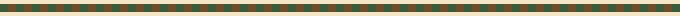

 

# Mamun

  
  
  
  
  
  

Hi — I’m a Statistics student passionate about data and technology.

I’m pursuing my B.Sc. in Statistics at National University, Bangladesh (2024–2028), and learning Computer Science online at the University of the People (2025–2029) so I can build practical tech skills that support my studies and future work.

Right now I’m strengthening Statistics and Python, and enjoying how the two fields fit together. Most evenings I’m either wrestling a small script or writing down what just clicked. On the side I hang around [AWS Builder Center](https://builder.aws.com/community/@mamunabdu) and keep notes on [Hashnode](https://mamunabdu.hashnode.dev).

### Currently learning
- **Python** — scripts, small CLIs, and cleaner problem-solving
- **AWS Builder Center** — reading, shipping notes, staying close to builders
- **Git / GitHub** — contribution workflow, issues, and PRs
- Looking for beginner-friendly open-source first issues to learn in public

### What I'm building
- [`extsort`](https://github.com/mamun-abdu/extsort) — small Python tooling
- [WishWeave](https://github.com/mamun-abdu/wishweave-showcase) — rough ideas → clearer next steps
- Bangla PDF helpers and simple HTML/CSS pages
- Goal: land a few beginner OSS pull requests and keep shipping

### Certifications
- [Stanford Code in Place](https://codeinplace.stanford.edu) (2025)
- Aspire Leaders Program, Cohort 4 (2025)
- EF SET English Certificate — C1 Advanced (2025)
- HerWILL AI Workshop (2026)

### Languages
- **Bengali** — native
- **English** — professional

### Skills
Python · Computer Science · Statistics · Blogging · Leadership · HTML/CSS · Git · AWS

  
  
  
  
  

  
  

I’m always excited to learn, ship small projects, and connect with people in tech — [say hi](https://x.com/mamunabdux).

