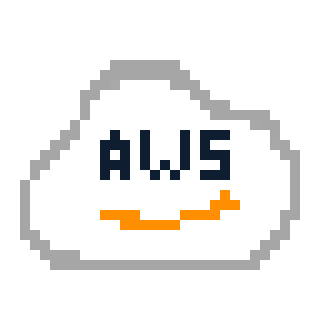

### Hi, I'm Mamun 👋

Learning to code by shipping small Python tools and writing about what clicks.

  <a href="https://mamunabdu.pro.bd">Website</a> ·
  <a href="https://mamunabdu.hashnode.dev">Blog</a> ·
  <a href="https://www.linkedin.com/in/mamunabdu">LinkedIn</a> ·
  <a href="https://x.com/mamunabdux">X</a> ·
  <a href="https://builder.aws.com/community/@mamunabdu">AWS Builder</a> ·
  <a href="https://linktr.ee/mamunabdu">Linktree</a> ·
  <a href="mailto:mamunabduhello@mamunabdu.pro.bd">Email</a>

  

---

- 🐍 Statistics undergrad picking up Computer Science
- 🌱 Currently learning: Python, Git/GitHub, AWS Builder Center, first OSS issues
- 🔨 Building: [csv-describe](https://github.com/mamun-abdu/csv-describe), [extsort](https://github.com/mamun-abdu/extsort), [bangla-pdfcheck](https://github.com/mamun-abdu/bangla-pdfcheck), [WishWeave](https://github.com/mamun-abdu/wishweave-showcase)
- 📫 Reach me: [mamunabduhello@mamunabdu.pro.bd](mailto:mamunabduhello@mamunabdu.pro.bd)

### Stack

  
  &nbsp;
  
  &nbsp;
  
  &nbsp;
  
  &nbsp;
  

