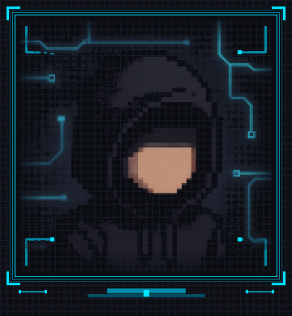

 

  
  
  
  
  
  

Stats student learning CS — mostly Python, small tools, and writing down what clicks. Evenings are scripts, notes, and the occasional AWS Builder scroll.

### Currently learning
- **Python** — scripts, small CLIs, cleaner problem-solving
- **AWS Builder Center** — reading, notes, staying close to builders
- **Git / GitHub** — issues, PRs, contribution flow
- Beginner-friendly OSS first issues — learning in public

### What I'm building
- [`extsort`](https://github.com/mamun-abdu/extsort) — small Python tooling
- [WishWeave](https://github.com/mamun-abdu/wishweave-showcase) — rough ideas → clearer next steps
- Bangla PDF helpers · simple HTML/CSS pages
- Goal: land a few beginner OSS PRs and keep shipping

  
  
  
  
  

 

[say hi](https://x.com/mamunabdux)

